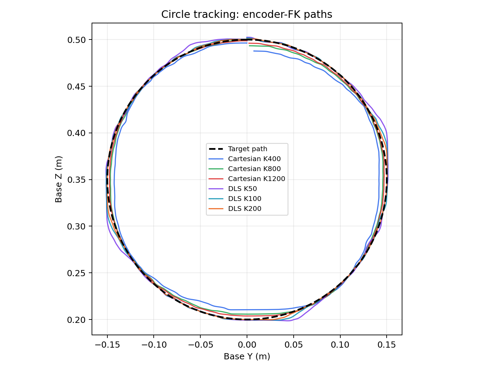
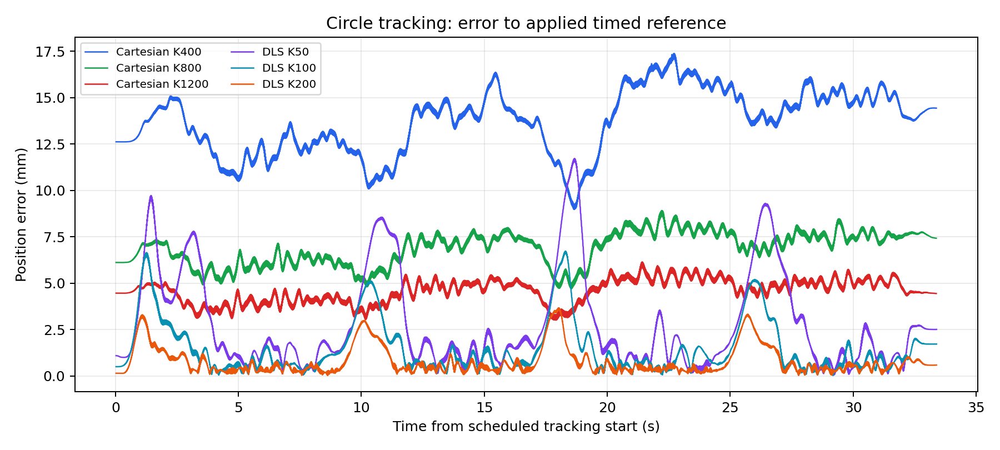
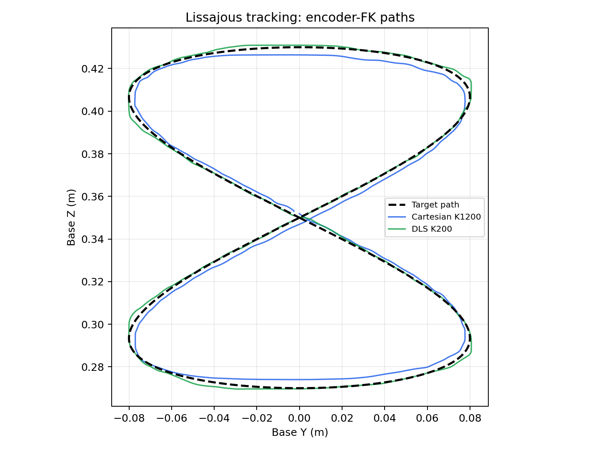
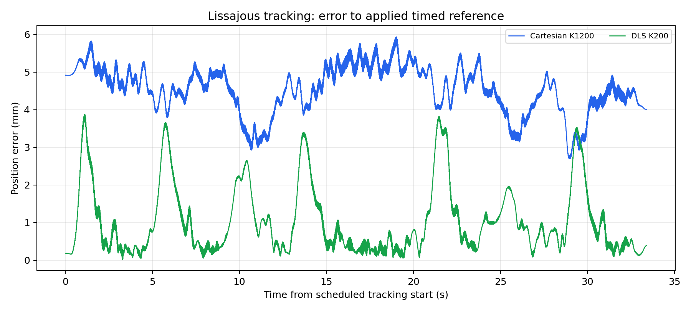
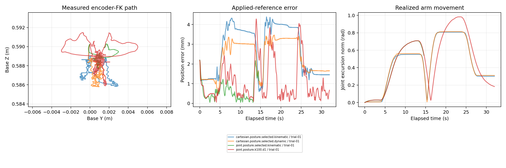
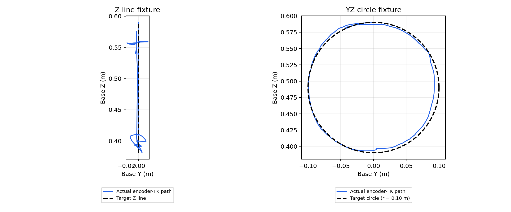
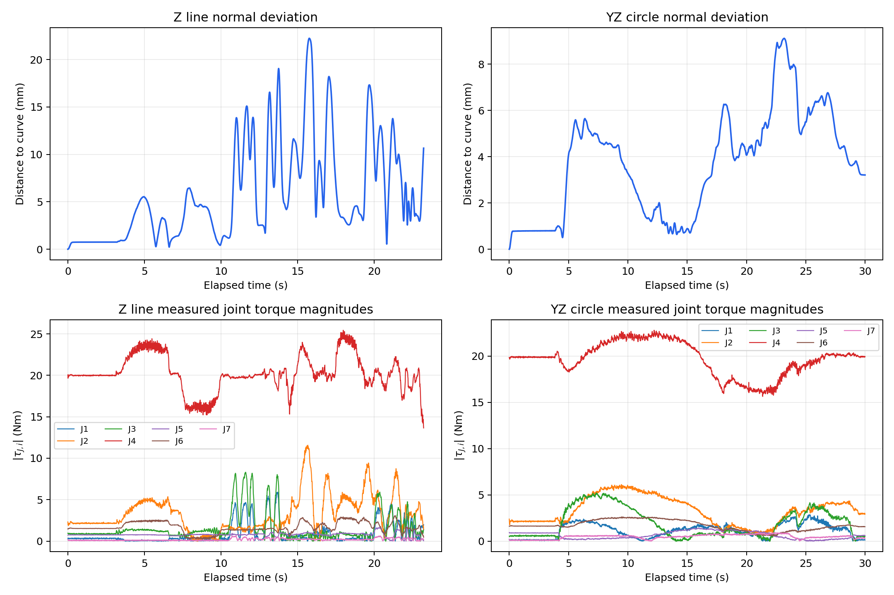

# FR3 hardware motion-control results

<!-- **Experiment date:** 2026-10-12. **Scope:** M4 model-based path tracking, stationary end-effector posture changes and hand-guided Cartesian curve fixtures. Earlier PPO deployments are outside this report. -->

The robot completed circle and Lissajous path demonstrations, three matched posture-controller cases, and three hand-guided 10 cm circle-fixture sessions. The lowest observed circle position error came from DLS with joint K200/D28.284. That gain profile faulted during posture changes; K100/D20 completed the posture task. The dynamic Cartesian projector improved position holding relative to the kinematic projector in the matched posture pair, but worsened orientation holding.

## Common setup, notation and measurement

A bare-flange FR3 ran a native C++ 1 kHz torque controller with Python Cartesian/posture references at 50 Hz. The retained stack uses firmware 5.9.2, FCI server 10 and libfranka 0.21.2. Franky was extended with dynamic torque projection, curve fixtures and a DLS-to-joint-PD route. 
<!-- This report describes those implemented controllers rather than PPO policies. -->

Let $q\in\mathbb R^7$ be encoder joint positions, $p(q)$ and $R(q)$ the model forward-kinematics flange pose, and $J(q)\in\mathbb R^{6\times7}$ the base-frame geometric Jacobian. Here $\mathrm{col}$ stacks column vectors. Then

$$
\nu=\mathrm{col}(v,\omega)=J(q)\dot q,\qquad
 e=\mathrm{col}\!\left(p_d-p,\mathrm{Log}(R_dR^T)^\vee\right).
$$

Position and orientation metrics are

$$
 E_p=\|p_d-p\|_2,\qquad
 E_R=\cos^{-1}\!\left[\mathrm{clip}\left(\frac{\mathrm{tr}(R^TR_d)-1}{2},-1,1\right)\right],
\qquad \mathrm{RMS}(E)=\sqrt{\frac1N\sum_{k=1}^N E_k^2}.
$$

All EE feedback is **encoder/model FK**, in `fr3_link0` with `fr3_flange` as the controlled frame. These are internal model-consistency/tracking measurements, not external pose metrology. Path results use the circle/Lissajous **track phase**, excluding 25 ms at recorded phase boundaries. Posture results use **all active phases**; fixture results use active guidance. Fault and stop samples are excluded from successful-task error metrics. Older exploratory runs use inferred robot-time phases; newer comparison runs use recorded consumed-reference sequences.

The client torque pipeline is

$$
 \tau_{\rm slew}=\tau_{J,d}^{\rm previous}
 +\mathrm{clip}(\tau_{\rm raw}-\tau_{J,d}^{\rm previous},-\Delta\tau_{\max},+\Delta\tau_{\max}),\quad \Delta\tau_{\max}=1\ \mathrm{Nm}.
$$

followed by libfranka's 100 Hz low-pass filter (`limit_rate=False`). Client model Coriolis compensation is included in $\tau_{\rm raw}$; **firmware adds gravity and motor-friction compensation**. Reported client torques exclude those firmware additions. No target-acceleration feedforward, integral correction or additional client friction compensation was used. Bounds, communication checks and the native stop remained active. [FCI torque pipeline](https://frankarobotics.github.io/docs/doc/libfranka/docs/overview.html).

## 1. Path tracking

### Task and controllers

The flange follows a timed Cartesian curve while maintaining a fixed orientation. Approach, settle and return-to-start segments surround the curve. The principal comparison used a base-frame YZ circle of radius $r=0.15$ m, center $c=(0.475,0,0.35)$ m and nominal phase speed $\dot\theta=0.2$ rad/s (steady linear speed 0.03 m/s). Phase speed ramps over 2 s. The comparison schedule uses 18 s approach, 4 s settle, approximately 33.42 s circle travel and 18 s exit.

Using the catalog's plane rotation $A=R_y(\pi/2)$,

$$
 p_d(\theta)=c+A[r\cos\theta,\ r\sin\theta,\ 0]^T,\qquad
 v_d=A[-r\sin\theta,\ r\cos\theta,\ 0]^T\dot\theta.
$$

The exploratory Lissajous curve uses the same plane and center, amplitudes $a=b=0.08$ m, and harmonics 1 and 2:

$$
 p_d(\theta)=c+A[a\sin\theta,\ b\sin2\theta,\ 0]^T,\qquad
 v_d=A[a\cos\theta,\ 2b\cos2\theta,\ 0]^T\dot\theta.
$$

**Cartesian impedance** maps pose and twist errors directly to a wrench:

$$
 w=K_x e+D_x(\nu_d-\nu),\qquad
 \tau_{\rm raw}=J^T w+c(q,\dot q)+P_\tau\tau_{\rm posture}+\tau_{\rm limits}.
$$

The implemented pose-error clips apply before multiplication by the gains. Nullspace posture gains are zero during circle tracking, so the chosen torque projector has no effect in this task.

**DLS with explicit joint PD** first converts pose/twist errors into joint velocity. With $S=\mathrm{diag}(1,1,1,0.2,0.2,0.2)$, $\bar J=SJ=U\Sigma V^T$ and $G=2I$ s$^{-1}$,

$$
 \dot q_{\rm primary}=\bar J^\dagger_\lambda S(\nu_d+Ge),\qquad
 \bar J^\dagger_\lambda=V\mathrm{diag}\left(\frac{\sigma_i}{\sigma_i^2+\lambda^2}\right)U^T,
 \quad\lambda=0.01.
$$

Here $\dagger_\lambda$ denotes the damped pseudoinverse defined above. Uniform scaling enforces joint-velocity bounds. At each native tick,

$$
 q_{{\rm ref},k+1}=q_{{\rm ref},k}+\Delta t_k\dot q_{{\rm ref},k},\qquad
 \tau_{\rm raw}=K_q(q_{\rm ref}-q)+D_q(\dot q_{\rm ref}-\dot q)+c(q,\dot q)+\tau_{\rm limits}.
$$

The integrator starts at measured $q$. There is no Ruckig trajectory generator in this explicit route. Soft joint-position bounds and a 0.15 rad per-joint reference-lag guard remain active.

### Circle gain comparison

One latest completed, smoothly stopped trial is shown per gain profile; prior nominal repeats are retained in the full evidence index. Cartesian rotational gains remain K=40 Nm/rad, D=13 Nms/rad. Joint gains apply to all seven joints. Cartesian translation units are N/m and Ns/m; joint units are Nm/rad and Nms/rad. “Contour” is geometric distance to the circle, which excludes along-curve phase error.

| Route | K | D | Position RMS (mm) | Orientation RMS (deg) | Contour RMS (mm) |
|---|---:|---:|---:|---:|---:|
| Cartesian | 400 | 40.000 | 13.853 | 1.823 | 7.450 |
| Cartesian | 800 | 42.426 | 6.980 | 1.863 | 3.569 |
| Cartesian | 800 | 56.569 | 6.953 | 1.837 | 3.589 |
| Cartesian | 800 | 70.711 | 6.974 | 1.861 | 3.585 |
| Cartesian | 1200 | 69.282 | 4.668 | 1.860 | 2.388 |
| DLS + joint PD | 50 | 14.142 | 3.853 | 0.374 | 3.247 |
| DLS + joint PD | 100 | 15.000 | 2.198 | 0.225 | 1.867 |
| DLS + joint PD | 100 | 20.000 | 2.080 | 0.202 | 1.717 |
| DLS + joint PD | 100 | 25.000 | 2.038 | 0.202 | 1.751 |
| DLS + joint PD | 200 | 28.284 | 1.107 | 0.111 | 0.941 |

The best observed position tracking was **Cartesian K1200/D69.282: 4.668 mm RMS**, versus **DLS joint K200/D28.284: 1.107 mm RMS**. Increasing stiffness helped in this sweep; changing nominal damping by ±25% produced much smaller differences. At the selected gains, orientation RMS was 1.860° for Cartesian and 0.111° for DLS. This is a comparison of full controller architectures, not a proof that joint PD is universally better.

The selected Cartesian and joint trials had maximum absolute unslewed client torques of 2.203 and 3.505 Nm, respectively. Slew limiting was active on approximately 0% and 3.48% of active samples. Circle-selected gains were then carried into posture testing; that transfer was not uniformly successful.

*Circle target and encoder-FK paths projected into base YZ. Cartesian K400/800/1200 and DLS joint K50/100/200 use their nominal damping ratios and the same representative trials as the table. Out-of-plane X error is included in the position-error plot below.*

*Three-dimensional error to each applied timed reference during tracking. Approach, settle, return and stop are excluded; curves are displayed every 10 ms without averaging, while tabulated metrics retain full-rate samples.*

Additional diagnostic: [aligned DLS K200 J1–J6 positions and reference reversals](hardware_control_audit/2026-10-12-m4-results/figures/circle-j1-j6.png). Red lines mark larger error peaks; green lines mark the corresponding joint-reference reversals.

### Lissajous follow-up with circle-selected gains

The selected Cartesian and DLS joint controllers were each run once on `lissajous_yz_small`. Both used center [0.475, 0, 0.35] m, plane rotation [0, 90, 0] degrees, amplitudes [0.08, 0.08] m, harmonics [1, 2], phase rate 0.2 rad/s and one cycle. Each session lasted approximately 73.416 s, including an 18 s approach, 4 s settle, approximately 33.416 s tracking phase and 18 s return. Secondary posture gains were zero. Cartesian rotational gains remained K40/D13; DLS settings were unchanged from the selected circle profile.

The table uses tracking-phase samples, excluding approach, settle, return and stop. Position error measures deviation from the applied timed reference; contour error measures distance to the geometric Lissajous curve.

| Route | K | D | Position RMS / max (mm) | Orientation RMS (deg) | Contour RMS (mm) |
|---|---:|---:|---:|---:|---:|
| Cartesian | 1200 | 69.282 | 4.603 / 6.062 | 1.780 | 2.704 |
| DLS + joint PD | 200 | 28.284 | 1.408 / 3.989 | 0.120 | 1.031 |

Both sessions completed with smooth stops and no dropped samples. Maximum difference between their initial encoder joint positions was 0.000197 rad per joint. DLS joint PD had lower observed position and orientation errors on this path as well as the circle; these are single-session comparisons, without a repeatability estimate. Lissajous contour distances use the nearest of 4,096 analytic curve samples; the maximum distance overestimate is bounded by 0.137 mm.

Sources: [Cartesian trial](/home/chen-lab/franka_ros2_ws/hardware_inventory/2026-10-12/m4/tracking.20261012T225714.056239Z/trial-01/m4-metrics.json), [DLS joint trial](/home/chen-lab/franka_ros2_ws/hardware_inventory/2026-10-12/m4/tracking.20261012T225905.208292Z/trial-01/m4-metrics.json), and [follow-up comparison report](/home/chen-lab/franka_ros2_ws/hardware_inventory/2026-10-12/m4/lissajous-comparison-report/report.md).

*The same Lissajous target with Cartesian K1200 and DLS joint K200 encoder-FK paths, projected into base YZ.*

*Three-dimensional error to the applied timed reference, displayed every 10 ms during tracking.*

Additional diagnostic: [aligned DLS K200 J1–J6 positions and reference reversals](hardware_control_audit/2026-10-12-m4-results/figures/lissajous-j1-j6.png). Red lines mark larger error peaks; green lines mark the corresponding joint-reference reversals.

<!-- ### Earlier completed path demonstrations

These were exploratory tuning/demonstration runs, not additional matched samples of the later gain sweep.

| Run (UTC suffix) | Path | Translation K / rotation K | Position RMS (mm) | Orientation RMS (deg) |
|---|---|---:|---:|---:|
| 142209Z | circle_yz_m2 | 800 / 20 | 7.115 | 3.845 |
| 142630Z | circle_yz_m2 | 800 / 20 | 7.050 | 3.796 |
| 142902Z | circle_yz_m2 | 800 / 40 | 7.193 | 2.013 |
| 143526Z | circle_yz_m2 | 800 / 40 | 7.195 | 1.945 |
| 144044Z | lissajous_yz_small | 800 / 40 | 6.709 | 1.745 |
| 144855Z | lissajous_yz_small | 800 / 40 | 6.686 | 1.714 |

Increasing rotational stiffness from 20 to 40 reduced orientation error in those exploratory circle runs. The two Lissajous trials completed with similar errors, but used only the Cartesian controller; these historical runs predate the selected-gain Lissajous comparison above. -->

<!-- Early low-gain trials ended on pose-error guards. Later trials also exposed command-delivery faults. `control_command_success_rate` measures delivery of the last 100 FCI commands, not tracking quality. One fault deteriorated from 94% to 41% during stopping and caused a firmware communication reflex. CPU `performance` mode and disabling active Ethernet EEE were followed by completed runs; these changes were not a controlled causal experiment. All failed trials remain indexed.

A three-repeat Cartesian session completed two runs, then rejected the third before motion because J1 had moved 0.119 rad relative to the initial anchor (0.1 rad repeat-start tolerance). With zero posture gains, returning the EE pose does not restore the original joint configuration. The subsequent sweep used one trial per profile. Starting configurations varied, and the joint K100 nominal representative predates EEE disabling. -->

## 2. Stationary EE posture control

### Task and equations

Hold a fixed flange position and orientation while moving the redundant arm through feasible posture targets A and B, then returning to the saved anchor. The matched trials used the same saved feasible joint targets and a 32 s sequence: 2 s initial hold, then A, B and return, each with a 6 s transition and 4 s settle.

The posture target is smoothly interpolated between endpoints:

$$
 q_p(u)=q_a+s(u)(q_b-q_a),\qquad
 s(u)=10u^3-15u^4+6u^5,\quad u\in[0,1].
$$

The **Cartesian route** retains the pose-holding wrench above and adds a secondary posture torque:

$$
 \tau_p=K_p(q_p-q)-D_p\dot q,\qquad
 \tau_{\rm raw}=J^T(K_xe-D_x\nu)+P_\tau\tau_p+c+\tau_{\rm limits}.
$$

The two projector choices are

$$
 P_{\rm kin}=I-J^+J,
 \qquad
 P_{\rm dyn}=I-J^T(JM^{-1}J^T)^+JM^{-1},
$$

where $M(q)$ is model joint inertia. The kinematic projector removes Euclidean Jacobian directions; the dynamic torque projector instead removes the secondary torque's task-acceleration contribution through $JM^{-1}$. Away from numerical rank cutoffs, $JM^{-1}P_{\rm dyn}=0$; generally $JM^{-1}P_{\rm kin}\ne0$. This distinction does not guarantee that dynamic projection improves every measured error in the real system.

The **DLS route** adds a secondary velocity instead of a secondary torque:

$$
 N_q=I-V_rV_r^T,\qquad
 \dot q_{\rm ref}=\bar J^\dagger_\lambda SGe+N_q\,\gamma(q_p-q),\quad\gamma=0.5\ \mathrm{s}^{-1}.
$$

$V_r$ contains the right singular vectors above the relative rank threshold $10^{-6}$. This is an orthogonal **kinematic velocity projector**, not $I-\bar J^\dagger_\lambda\bar J$. The resulting velocity is bounded, integrated and tracked by joint PD as in path tracking. The torque- and velocity-level secondary gains are not equivalent parameters.

### Matched posture results

Cartesian primary gains: translation K1200/D69.282, rotation K40/D13. Cartesian secondary gains: K10/D2.236. DLS secondary rate gain: 0.5/s. Starts were closely matched: the maximum pairwise per-joint difference across the four runs was 0.000202 rad. The exact same saved posture-plan hash was used throughout.

| Controller | Position RMS / max (mm) | Orientation RMS / max (deg) | Maximum joint excursion norm (rad) | A / B / return settled | Outcome |
|---|---:|---:|---:|---|---|
| Cartesian + kinematic | 2.999 / 4.390 | 0.600 / 1.469 | 0.808 | no / no / no | Complete |
| Cartesian + dynamic | 2.516 / 3.464 | 1.655 / 2.089 | 0.814 | no / no / no | Complete |
| DLS K100/D20 + kinematic | 1.467 / 4.281 | 0.249 / 1.478 | 0.983 | yes / no / yes | Complete |
| DLS K200/D28.284 + kinematic | — | — | — | Incomplete | J7 torque guard |

“Excursion” is $\max_t\|q(t)-q(0)\|_2$, not a single-joint rotation. Settling requires **all** of $\|q_p-q\|_2\le0.05$ rad, $E_p\le10$ mm and $E_R\le0.05$ rad for 0.5 s. A completed session means the sequence executed and stopped; it does not mean every settling target passed.

Dynamic Cartesian projection reduced position RMS by about 16% but increased orientation RMS by approximately 2.76× compared with the kinematic projector. Both moved substantially and had similar excursion; neither passed the strict joint-posture settling criterion. DLS K100/D20 produced lower pose error and larger movement, passing A and return but not B.

| Controller | Last 0.5 s posture-error norm: A / B / return (rad) |
|---|---:|
| Cartesian + kinematic | 0.180 / 0.221 / 0.151 |
| Cartesian + dynamic | 0.176 / 0.219 / 0.159 |
| DLS K100/D20 + kinematic | 0.030 / 0.073 / 0.035 |

For DLS K100, the B settle tail had only 0.436 mm EE position error and 0.063° orientation error, but 0.073 rad posture error, above the 0.05 rad criterion. Good EE holding therefore did not establish full posture convergence.

<!-- The circle-selected joint K200/D28.284 trial faulted 14.603 s into the sequence during B transition. Reconstructed unslewed J7 torque reached **8.314 Nm** against its 8 Nm guard: approximately 0.456 Nm position contribution plus 7.858 Nm damping contribution. J7 velocity oscillated while the desired velocity was positive and measured velocity negative. The first fault sample's raw torque was overwritten by the stop law, so this triggering value was reconstructed from retained references, measured state and gains; it is not a measurement of transmitted torque. Communication success was 100% near the fault. Smooth stop succeeded. Partial-run errors are excluded from the completed-controller table. -->

<!-- ### Earlier posture tuning

All four exploratory sessions below completed, but gains, target excursions and starting conditions changed. They are not projector-only ablations.

| Run (UTC suffix) | Projector | Secondary K / D | Requested design offset (rad) | Realized maximum excursion norm (rad) | Position RMS (mm) | Orientation RMS (deg) |
|---|---|---:|---:|---:|---:|---:|
| 145424Z | kinematic | 2 / 1.000 | 0.6 | 0.014 | 1.324 | 0.146 |
| 150157Z | dynamic | 10 / 2.236 | 0.6 | 0.423 | 3.467 | 1.587 |
| 150500Z | dynamic | 10 / 2.236 | 0.9 | 0.700 | 3.506 | 1.805 |
| 151116Z | dynamic | 10 / 2.236 | 0.9 | 0.707 | 3.582 | 1.664 |

The first low-secondary-gain session had small pose errors because the arm barely moved (0.014 rad excursion norm). It illustrates why posture evaluation must report realized movement and target attainment alongside EE error. “Design offset” is the planner's excursion request, not an assertion that every joint moved by that angle. -->

*First figure from the posture comparison report: measured YZ position, position error and realized joint excursion. It includes the three completed comparison cases and the partial DLS K200 trial that ended at the torque guard; the latter is not a completed-task result.*

## 3. Curve-constrained Cartesian impedance

### Task and equations

The operator hand-guides the flange along a virtual curve. The controller resists normal displacement and orientation changes while allowing damped tangent motion. Unlike path tracking, there is **no prescribed traversal phase or speed**. Two geometries were implemented: a vertical Z line and a YZ circle.

Let $\pi(p)$ be the nearest point on the curve and $t$ its unit tangent. Define

$$
 P_t=tt^T,\quad P_n=I-P_t,\quad
 F=K_n[\pi(p)-p]-D_nP_nv-D_tP_tv,
 \qquad m=K_Re_R-D_R\omega.
$$

Then $\tau_{\rm raw}=J^T[F^T,m^T]^T+c+\tau_{\rm limits}$; secondary posture gains were zero. There is no tangent spring. Here $P_t/P_n$ project **Cartesian velocity**, and are distinct from the joint nullspace projectors used for posture control.

For a Z line through $(x_0,y_0)$,

$$
 \pi(p)=(x_0,y_0,p_z)^T,\qquad t=(0,0,1)^T.
$$

For a YZ circle centered at $c$ with radius $r$, let

$$
 \rho=(0,p_y-c_y,p_z-c_z)^T,\quad u=\rho/\|\rho\|,\quad
 \pi(p)=c+ru,\quad t=(0,-u_z,u_y)^T.
$$

Projection at the circle center is undefined and guarded. The measured geometric normal distance is

$$
 d_{\mathcal C}=\|p-\pi(p)\|_2
 =\sqrt{(p_x-c_x)^2+(\|\rho\|-r)^2}.
$$

The hand-guided circle uses **r=0.10 m**, not the 0.15 m timed tracking circle. Its center is anchored to measured entry pose so the initial flange lies at the top of the circle. Orientation is held at the entry orientation.

### Final hand-guided fixture results

Only the final Z-line and YZ-circle sessions are reported here. Earlier tuning runs remain in the evidence inventory. Both used rotational K40/D13 and zero secondary posture gains. Normal stiffness is in N/m; normal and tangent damping are in Ns/m. Errors below use active guidance samples, excluding the fault-triggering sample and stopping interval for the Z line.

| Task / final session (UTC suffix) | Normal K / D; tangent D | Active duration (s) | Normal-distance RMS / max (mm) | Orientation RMS / max (deg) | Outcome |
|---|---|---:|---:|---:|---|
| Z line — 161636Z | 800 / 57; 40 | 23.232 | 7.707 / 22.239 | 1.368 / 3.520 | Mostly successful guidance; speed guard at release; smooth stop |
| YZ circle — 164958Z | 1200 / 69.81; 20 | approximately 30 | 4.328 / 9.116 | 2.082 / 3.416 | Complete; smooth stop |

<!-- **Z-line guidance.** The operator confirmed that this final trial was mostly successful and that the Cartesian-speed guard triggered at the end when the robot was released. The 23.232 s of preceding guidance data are retained as valid fixture-performance measurements. For a Z line, normal distance is the lateral offset $\sqrt{(p_x-x_0)^2+(p_y-y_0)^2}$; intended vertical travel does not count as error. The active window contained 23,232 samples, with maximum linear speed 0.14996 m/s before the 0.15 m/s guard. Command success remained 100%, there were no dropped samples, and the subsequent stop completed smoothly. The recorded terminal status remains `fault / cartesian_speed`; this release-associated termination does not invalidate the preceding guidance data. Release timing is operator-reported, rather than a separately timestamped event in the log.

**YZ-circle guidance.** The final trial used a 0.10 m radius and lasted approximately 30 s. Its measured unwrapped angular span was 385.3°, with net guided travel of approximately −382.5°, demonstrating more than one revolution. Angular span includes reversals and is not automatic phase tracking. Maximum observed linear speed was 0.0702 m/s. The session completed with no dropped samples and a smooth 0.302 s stop.

A residual normal offset of approximately 3.209 mm remained near the end of circle guidance. The corresponding computed spring-force magnitude was about 3.85 N; this is a controller value, **not a measured external force**. No integral term was used. Residual friction/model bias is plausible but unidentified; firmware motor-friction compensation was still present. Hands-off release time was not recorded, so the final window does not establish a controlled hands-off equilibrium.

On stop, the native controller captures the actual pose and transitions to full six-axis pose holding; it deliberately does not snap to the nearest curve point. The final circle stop had maximum captured-pose drift of 0.565 mm and 0.081°. Thus failure to correct an off-curve offset after the session ends is consistent with the stop design, not evidence that the active fixture spring was absent. -->

*Final Z-line and YZ-circle sessions: target geometry and encoder-FK path projected into base YZ. The vertical line spans the observed Z excursion; it is not a scheduled trajectory. Out-of-plane deviation is included in the three-dimensional normal-distance calculation.*

*Top: distance to the respective curve during active guidance. Bottom: absolute measured joint torque for J1–J7, including gravity-related joint loads, rather than the client-only torque command. These are joint torque measurements, not calibrated hand forces. Fault-triggering and stopping samples are excluded. The Z-line speed guard occurred at release according to the operator.*

## Interpretation and reporting limits

- The ten-profile circle sweep supports choosing provisional gains; it does not establish repeatability or statistical superiority. Most gain cases have one completed trial.
- For the preliminary three-case posture report, use Cartesian kinematic, Cartesian dynamic and DLS K100/D20, while retaining K200's torque failure as a transfer limitation. None achieved every strict settling goal.
- The final Z-line and YZ-circle sessions demonstrate virtual fixtures with millimeter-scale normal offsets and free tangent travel. The Z-line speed guard occurred at release according to the operator; its preceding active data remain valid. Manual-force variation prevents calibrated impedance identification or direct performance ranking between the two geometries.
- All errors depend on encoder/model FK. No independent pose sensor, calibrated hand-force input, friction identification or acceleration-feedforward comparison was available.
- Gains, initial conditions and communication settings changed during exploratory tuning. Successful historical trials must not be pooled as if they were controlled identical repetitions. Guards, stop failures and rejected pre-motion starts are part of the results.

## Evidence and complete run inventory

Portable numeric evidence is stored in [results-index.json](hardware_control_audit/2026-10-12-m4-results/results-index.json), including executed controllers, report/config hashes, available phase metrics and exact raw-data directories. Full raw logs remain under `/home/chen-lab/franka_ros2_ws/hardware_inventory/2026-10-12/m4/`.

Supporting reports: [circle selection](franky_runtime/M4_POSTURE_SELECTED.md), [posture audit](franky_runtime/M4_POSTURE_AUDIT.md), [communication investigation](franky_runtime/M4_COMMUNICATION_INVESTIGATION.md). Plot artifacts are in the [circle report](/home/chen-lab/franka_ros2_ws/hardware_inventory/2026-10-12/m4/circle-comparison-report/report.md) and [posture report](/home/chen-lab/franka_ros2_ws/hardware_inventory/2026-10-12/m4/posture-comparison-report/report.md).

Implementation equations were checked against the native [Cartesian impedance law](/home/chen-lab/yifan/franky-source-f88f0e9b/src/motion/cartesian_impedance_base.cpp:217), [M4 DLS/stop runtime](/home/chen-lab/yifan/franky-source-f88f0e9b/src/motion/m4_runtime_motion.cpp:23), [projector definitions](/home/chen-lab/yifan/franky-source-f88f0e9b/include/franky/motion/nullspace_projector.hpp:7) and [curve projection/force law](/home/chen-lab/yifan/franky-source-f88f0e9b/src/motion/cartesian_curve_impedance_motion.cpp:47).

The following inventory covers all saved runs for the three tasks, including exploratory failures and no-motion checks. Hold-only commissioning is outside these task tables. Session/trial identifiers link to their original reports; empty stop evidence is shown as “—”.

| Task | Session / trial (UTC) | Status / reason | Smooth stop |
|---|---|---|---|
| posture | [posture.20261012T145424Z](/home/chen-lab/franka_ros2_ws/hardware_inventory/2026-10-12/m4/posture.20261012T145424Z/report.json) | complete | yes |
| posture | [posture.20261012T150157Z](/home/chen-lab/franka_ros2_ws/hardware_inventory/2026-10-12/m4/posture.20261012T150157Z/report.json) | complete | yes |
| posture | [posture.20261012T150500Z](/home/chen-lab/franka_ros2_ws/hardware_inventory/2026-10-12/m4/posture.20261012T150500Z/report.json) | complete | yes |
| posture | [posture.20261012T151116Z](/home/chen-lab/franka_ros2_ws/hardware_inventory/2026-10-12/m4/posture.20261012T151116Z/report.json) | complete | yes |
| posture | [posture.20261012T203423.061308Z/trial-01](/home/chen-lab/franka_ros2_ws/hardware_inventory/2026-10-12/m4/posture.20261012T203423.061308Z/trial-01/report.json) | complete | yes |
| posture | [posture.20261012T203520.607872Z/trial-01](/home/chen-lab/franka_ros2_ws/hardware_inventory/2026-10-12/m4/posture.20261012T203520.607872Z/trial-01/report.json) | complete | yes |
| posture | [posture.20261012T203633.979613Z/trial-01](/home/chen-lab/franka_ros2_ws/hardware_inventory/2026-10-12/m4/posture.20261012T203633.979613Z/trial-01/report.json) | fault / command_torque | yes |
| posture | [posture.20261012T203826.650984Z/trial-01](/home/chen-lab/franka_ros2_ws/hardware_inventory/2026-10-12/m4/posture.20261012T203826.650984Z/trial-01/report.json) | complete | yes |
| tracking | [tracking.20261012T134442Z](/home/chen-lab/franka_ros2_ws/hardware_inventory/2026-10-12/m4/tracking.20261012T134442Z/report.json) | fault / pose_error | yes |
| tracking | [tracking.20261012T134815Z](/home/chen-lab/franka_ros2_ws/hardware_inventory/2026-10-12/m4/tracking.20261012T134815Z/report.json) | fault / pose_error | yes |
| tracking | [tracking.20261012T135441Z](/home/chen-lab/franka_ros2_ws/hardware_inventory/2026-10-12/m4/tracking.20261012T135441Z/report.json) | fault / pose_error | yes |
| tracking | [tracking.20261012T135719Z](/home/chen-lab/franka_ros2_ws/hardware_inventory/2026-10-12/m4/tracking.20261012T135719Z/report.json) | fault / command_success | yes |
| tracking | [tracking.20261012T140931Z](/home/chen-lab/franka_ros2_ws/hardware_inventory/2026-10-12/m4/tracking.20261012T140931Z/report.json) | fault / command_success | yes |
| tracking | [tracking.20261012T141550Z](/home/chen-lab/franka_ros2_ws/hardware_inventory/2026-10-12/m4/tracking.20261012T141550Z/report.json) | complete / no_motion_preflight (no task motion) | — |
| tracking | [tracking.20261012T141804Z](/home/chen-lab/franka_ros2_ws/hardware_inventory/2026-10-12/m4/tracking.20261012T141804Z/report.json) | fault / command_success | yes |
| tracking | [tracking.20261012T142209Z](/home/chen-lab/franka_ros2_ws/hardware_inventory/2026-10-12/m4/tracking.20261012T142209Z/report.json) | complete | yes |
| tracking | [tracking.20261012T142630Z](/home/chen-lab/franka_ros2_ws/hardware_inventory/2026-10-12/m4/tracking.20261012T142630Z/report.json) | complete | yes |
| tracking | [tracking.20261012T142902Z](/home/chen-lab/franka_ros2_ws/hardware_inventory/2026-10-12/m4/tracking.20261012T142902Z/report.json) | complete | yes |
| tracking | [tracking.20261012T143526Z](/home/chen-lab/franka_ros2_ws/hardware_inventory/2026-10-12/m4/tracking.20261012T143526Z/report.json) | complete | yes |
| tracking | [tracking.20261012T144044Z](/home/chen-lab/franka_ros2_ws/hardware_inventory/2026-10-12/m4/tracking.20261012T144044Z/report.json) | complete | yes |
| tracking | [tracking.20261012T144855Z](/home/chen-lab/franka_ros2_ws/hardware_inventory/2026-10-12/m4/tracking.20261012T144855Z/report.json) | complete | yes |
| tracking | [tracking.20261012T191434.905431Z/trial-01](/home/chen-lab/franka_ros2_ws/hardware_inventory/2026-10-12/m4/tracking.20261012T191434.905431Z/trial-01/report.json) | fault / command_success | yes |
| tracking | [tracking.20261012T191631.743364Z/trial-01](/home/chen-lab/franka_ros2_ws/hardware_inventory/2026-10-12/m4/tracking.20261012T191631.743364Z/trial-01/report.json) | fault / command_success | yes |
| tracking | [tracking.20261012T192434.656877Z/trial-01](/home/chen-lab/franka_ros2_ws/hardware_inventory/2026-10-12/m4/tracking.20261012T192434.656877Z/trial-01/report.json) | complete | yes |
| tracking | [tracking.20261012T192842.666764Z/trial-01](/home/chen-lab/franka_ros2_ws/hardware_inventory/2026-10-12/m4/tracking.20261012T192842.666764Z/trial-01/report.json) | complete | yes |
| tracking | [tracking.20261012T193136.408499Z/trial-01](/home/chen-lab/franka_ros2_ws/hardware_inventory/2026-10-12/m4/tracking.20261012T193136.408499Z/trial-01/report.json) | complete | yes |
| tracking | [tracking.20261012T193136.408499Z/trial-02](/home/chen-lab/franka_ros2_ws/hardware_inventory/2026-10-12/m4/tracking.20261012T193136.408499Z/trial-02/report.json) | complete | yes |
| tracking | [tracking.20261012T193136.408499Z/trial-03](/home/chen-lab/franka_ros2_ws/hardware_inventory/2026-10-12/m4/tracking.20261012T193136.408499Z/trial-03/report.json) | fault / repeat start joint drift exceeds tolerance; no automatic homing (no task motion) | — |
| tracking | [tracking.20261012T194210.983461Z/trial-01](/home/chen-lab/franka_ros2_ws/hardware_inventory/2026-10-12/m4/tracking.20261012T194210.983461Z/trial-01/report.json) | fault / command_success | no |
| tracking | [tracking.20261012T195600.810579Z/trial-01](/home/chen-lab/franka_ros2_ws/hardware_inventory/2026-10-12/m4/tracking.20261012T195600.810579Z/trial-01/report.json) | complete | yes |
| tracking | [tracking.20261012T195922.890637Z/trial-01](/home/chen-lab/franka_ros2_ws/hardware_inventory/2026-10-12/m4/tracking.20261012T195922.890637Z/trial-01/report.json) | complete | yes |
| tracking | [tracking.20261012T200103.196154Z/trial-01](/home/chen-lab/franka_ros2_ws/hardware_inventory/2026-10-12/m4/tracking.20261012T200103.196154Z/trial-01/report.json) | complete | yes |
| tracking | [tracking.20261012T200239.711198Z/trial-01](/home/chen-lab/franka_ros2_ws/hardware_inventory/2026-10-12/m4/tracking.20261012T200239.711198Z/trial-01/report.json) | complete | yes |
| tracking | [tracking.20261012T200417.546331Z/trial-01](/home/chen-lab/franka_ros2_ws/hardware_inventory/2026-10-12/m4/tracking.20261012T200417.546331Z/trial-01/report.json) | complete | yes |
| tracking | [tracking.20261012T200601.782023Z/trial-01](/home/chen-lab/franka_ros2_ws/hardware_inventory/2026-10-12/m4/tracking.20261012T200601.782023Z/trial-01/report.json) | complete | yes |
| tracking | [tracking.20261012T200735.351908Z/trial-01](/home/chen-lab/franka_ros2_ws/hardware_inventory/2026-10-12/m4/tracking.20261012T200735.351908Z/trial-01/report.json) | complete | yes |
| tracking | [tracking.20261012T200914.374036Z/trial-01](/home/chen-lab/franka_ros2_ws/hardware_inventory/2026-10-12/m4/tracking.20261012T200914.374036Z/trial-01/report.json) | complete | yes |
| tracking | [tracking.20261012T201538.289553Z/trial-01](/home/chen-lab/franka_ros2_ws/hardware_inventory/2026-10-12/m4/tracking.20261012T201538.289553Z/trial-01/report.json) | complete | yes |
| yz_circle | [yz_circle.20261012T163205Z](/home/chen-lab/franka_ros2_ws/hardware_inventory/2026-10-12/m4/yz_circle.20261012T163205Z/report.json) | complete | yes |
| yz_circle | [yz_circle.20261012T163526Z](/home/chen-lab/franka_ros2_ws/hardware_inventory/2026-10-12/m4/yz_circle.20261012T163526Z/report.json) | complete | yes |
| yz_circle | [yz_circle.20261012T164958Z](/home/chen-lab/franka_ros2_ws/hardware_inventory/2026-10-12/m4/yz_circle.20261012T164958Z/report.json) | complete | yes |
| z_line | [z_line.20261012T151511Z](/home/chen-lab/franka_ros2_ws/hardware_inventory/2026-10-12/m4/z_line.20261012T151511Z/report.json) | fault / pose_error | yes |
| z_line | [z_line.20261012T151711Z](/home/chen-lab/franka_ros2_ws/hardware_inventory/2026-10-12/m4/z_line.20261012T151711Z/report.json) | fault / cartesian_speed | no |
| z_line | [z_line.20261012T154821Z](/home/chen-lab/franka_ros2_ws/hardware_inventory/2026-10-12/m4/z_line.20261012T154821Z/report.json) | fault / cartesian_speed | yes |
| z_line | [z_line.20261012T155441Z](/home/chen-lab/franka_ros2_ws/hardware_inventory/2026-10-12/m4/z_line.20261012T155441Z/report.json) | fault / pose_error | yes |
| z_line | [z_line.20261012T160013Z](/home/chen-lab/franka_ros2_ws/hardware_inventory/2026-10-12/m4/z_line.20261012T160013Z/report.json) | fault / joint_velocity | no |
| z_line | [z_line.20261012T160859Z](/home/chen-lab/franka_ros2_ws/hardware_inventory/2026-10-12/m4/z_line.20261012T160859Z/report.json) | fault / pose_error | no |
| z_line | [z_line.20261012T161419Z](/home/chen-lab/franka_ros2_ws/hardware_inventory/2026-10-12/m4/z_line.20261012T161419Z/report.json) | fault / cartesian_speed | yes |
| z_line | [z_line.20261012T161636Z](/home/chen-lab/franka_ros2_ws/hardware_inventory/2026-10-12/m4/z_line.20261012T161636Z/report.json) | fault / cartesian_speed | yes |
| tracking | [tracking.20261012T225714.056239Z/trial-01](/home/chen-lab/franka_ros2_ws/hardware_inventory/2026-10-12/m4/tracking.20261012T225714.056239Z/trial-01/report.json) | complete | yes |
| tracking | [tracking.20261012T225905.208292Z/trial-01](/home/chen-lab/franka_ros2_ws/hardware_inventory/2026-10-12/m4/tracking.20261012T225905.208292Z/trial-01/report.json) | complete | yes |
